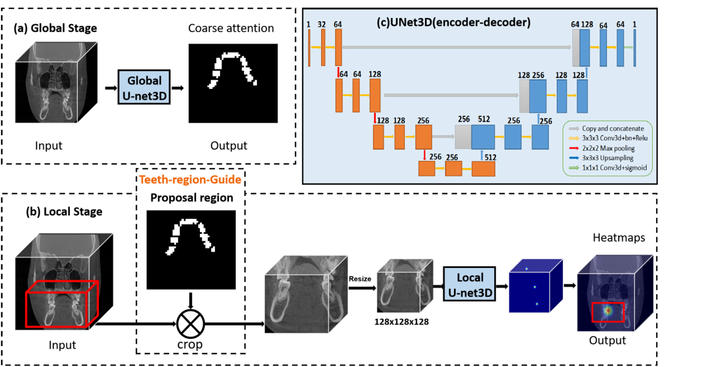

<p align="center">
    
</p>

We developed a coarse-to-fine deep learning framework for automatic assessment of maxillary and mandibular basal bone width from CBCT scans. The model accurately detects anatomical landmarks and performs fully automated measurements, achieving high agreement with expert annotations (CCC = 0.96-0.98). This framework demonstrates the potential of AI-assisted orthodontic diagnosis for identifying maxillary transverse deficiency and supporting individualized treatment planning.

<b>Cone-beam CT landmark detection for measuring basal bone width: a retrospective validation study</b> <br/>
[Juan Dai](https://sugh.szu.edu.cn/Html/Doctors/Main/Index_269.html), [Xinge Guo](https://scholar.google.com/citations?user=O4VUUiwAAAAJ&hl=en), Hongyuan Zhang, Haoyu Xie, Jiahui Huang, [Bingsheng Huang](https://scholar.google.com/citations?user=h1Sa2bYAAAAJ&hl=en)* <br/>
*Shenzhen University General Hospital, Medical AI Lab, Shenzhen University Medical School* <br/>
<a href='https://drive.google.com/file/d/19bbRXSrsk3S-C-qQEvTBNxwIGoUeRcgP/view?usp=sharing'></a>
<a href='https://link.springer.com/article/10.1186/s12903-024-04798-2'></a>


## Main Results

> [!NOTE]
> The models were trained on 80 CBCT scans, validated on 10 scans, and tested on an additional 34 scans.


### 3D U-Net

| Stage | Model Architecture | Best Epoch | Train Resolution | DSC/SDR@2mm | Trained Model |
| :---: | :---: | :---: | :---: | :---: | :---: |
| Stage 1 | U-Net | 52 | 128x128x128 | 88.92 | [checkpoint](https://drive.google.com/file/d/1FSiQpdRQJt8hxm6YOwWqvdlq0pcbTSWI/view?usp=sharing)/[log](https://drive.google.com/file/d/1S80LhAMo7IEG0AH8wWBJlFV6s8peiDnU/view?usp=sharing) |
| Stage 2  | U-Net | 180 | 128x128x128 | 71.34 | [checkpoint](https://drive.google.com/file/d/1JlVmdMQd8lukgbPqKWHyLdj2ETtfvabz/view?usp=sharing)/[log](https://drive.google.com/file/d/1k6c1f8qaW6x-XH6rn8yy3u5dzH8hcD8z/view?usp=sharing) |


> **Easy to Reproduce** Prepare the CBCT images, segmentation masks, and 3D Slicer landmark annotations described in [DATASET.md](DATASET.md). Then run the training scripts ([train_stage1.py](train_stage1.py) and [train_stage2.py](train_stage2.py)) and the inference scripts ([inference_stage1.py](inference_stage1.py) and [inference_stage2.py](inference_stage2.py)). 


### Basal Bone Width Measurements

| Measurement | CCC [95% CI] | MSE (mm) | T-test p-value |
| :---: | :---: | :---: | :---: |
| Maxillary Basal Bone Width | 0.96 [0.94–0.97] | 1.22±1.93 | 0.37 |
| Mandibular Basal Bone Width  | 0.98 [0.97–0.99] | 0.68±0.82 | 0.67 |

<sub><i>CCC: concordance correlation coefficient; CI: confidence interval; P-value: The one-sample T test was used to compare basal bone width measurement error.</i></sub>

## Citation

If you use the code or methods in this repository, please cite:

```
@article{dai2024cone,
  title={Cone-beam CT landmark detection for measuring basal bone width: a retrospective validation study},
  author={Dai, Juan and Guo, Xinge and Zhang, Hongyuan and Xie, Haoyu and Huang, Jiahui and Huang, Qiangtai and Huang, Bingsheng},
  journal={BMC Oral Health},
  volume={24},
  number={1},
  pages={1091},
  year={2024},
  publisher={Springer}
}
```

## Acknowledgement

The work was supported by the Science Technology and Innovation Committee of Shenzhen (No.20220808170713001), Medicine Plus Program of Shenzhen University (No. 2024YG020), the Beijing Natural Science Foundation(Grant No. L232112) and the National Natural Science Foundation of China (No. U2013205 and No. 62371303).

For questions about the paper, please contact [Bingsheng Huang](https://scholar.google.com/citations?user=h1Sa2bYAAAAJ&hl=en) (huangb@szu.edu.cn) at the Medical AI Lab, School of Biomedical Engineering, Shenzhen University Medical School. For code-related questions, please open a GitHub issue.